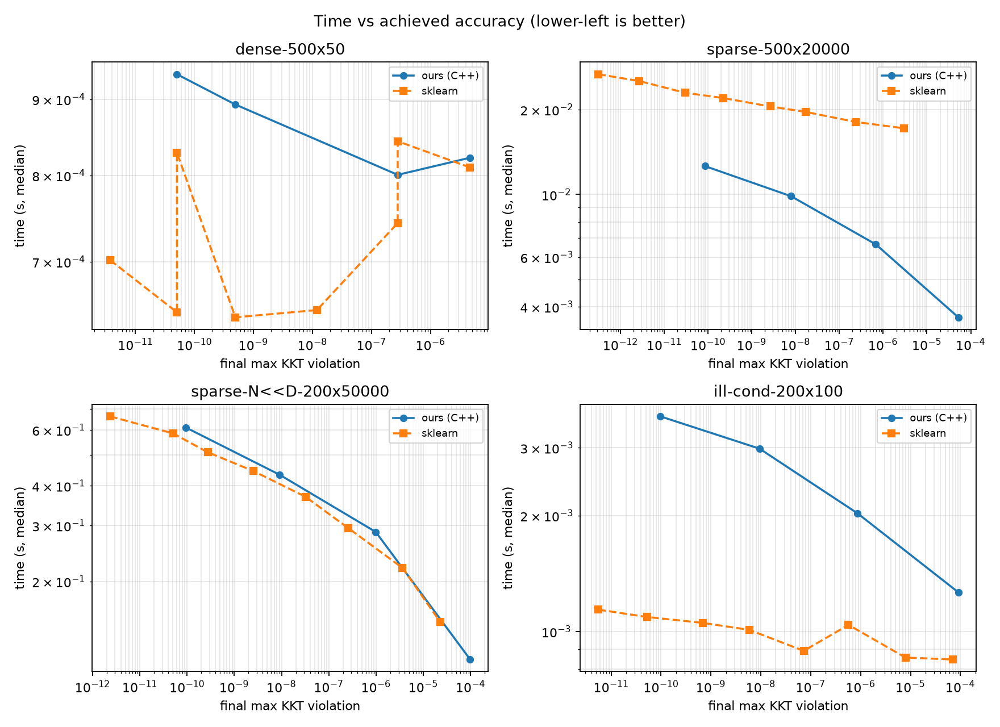
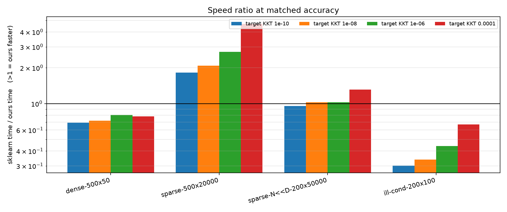
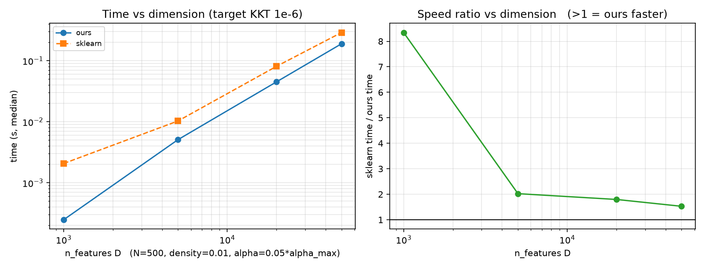

# enet-solver

A sparse **ElasticNet** solver written from scratch: a NumPy reference implementation plus a
C++ (pybind11) core.

> **This is a learning project.** It exists to understand the math and the systems behind
> regularized linear models, and to compare against scikit-learn for fun. It is **not** a
> production replacement for scikit-learn, and it is not trying to be one.

## Why this exists

- Understand coordinate descent, soft-thresholding, and the KKT / duality-gap stopping rule.
- Practice sparse numerics (CSC layout, residual updates) and a real C++ extension.
- Run honest, apples-to-apples-ish comparisons with scikit-learn — and write down where this
  implementation wins, loses, and why.

The interesting part is not the model (it is "just" linear regression with a penalty). It is
the **solver**: a convex optimization routine with no closed-form solution.

## Documentation

Theory notes live in [`docs/theory.md`](docs/theory.md). They walk through the whole chain:

```
OLS → why it fails → Ridge / Lasso / ElasticNet → why L1 gives sparsity
    → KKT conditions → soft-thresholding → coordinate descent
    → stopping criteria → regularization path & warm start
```

Read the docs before reading the code — every function in `src/enet/reference.py` maps back to
a section there.

## What it does

Solves

$$
f(w, b) = \frac{1}{2N} \|y - Xw - b\mathbf{1}\|_2^2 + \alpha \cdot \rho \|w\|_1 + \frac{1}{2} \alpha (1 - \rho) \|w\|_2^2
$$

for dense or sparse $X$. $\rho=1$ is Lasso, $\rho=0$ is Ridge, anything in between is
ElasticNet. Supports `fit_intercept`, KKT-based stopping, duality-gap reporting, and a
warm-started regularization path.

## Install & run

```bash
python -m venv .venv
.venv/bin/pip install -e ".[test,bench]"

.venv/bin/python -m pytest -q
.venv/bin/python scripts/gen_data.py
OMP_NUM_THREADS=1 OPENBLAS_NUM_THREADS=1 MKL_NUM_THREADS=1 \
    .venv/bin/python bench/bench.py
```

The benchmark writes its raw data, tables and figures to `bench/results/` and
`docs/figures/`. Use `--quick --repeat 1` for a fast smoke run.

## Design

| File | Role |
|---|---|
| `src/enet/reference.py` | NumPy coordinate descent — readable, used as a correctness oracle |
| `src/enet/_core.cpp` | Same loop over a CSC matrix in C++ |
| `src/enet/backend.py` | Thin Python wrapper around the C++ core |
| `tests/` | scikit-learn comparison, edge cases, C++ vs reference |
| `bench/bench.py` | Timing harness with an explicit protocol |
| `scripts/gen_data.py` | Synthetic dense / sparse / ill-conditioned data |

Both backends implement the same update:

$$
\begin{aligned}
\rho_j &= x_j^\top r + w_j z_j \\
w_j    &\leftarrow \frac{S(\rho_j, N \lambda_1)}{z_j + N \lambda_2} \\
r      &\leftarrow r - (w_j^{\text{new}} - w_j) x_j
\end{aligned}
$$

Sparse updates cost $\mathcal{O}(\text{nnz}_j)$ per coordinate because the intercept is tracked as a scalar and
the residual is kept in its uncentered form.

## Benchmark (honest, at matched accuracy)

Machine: AMD Ryzen 7 7735HS, `OMP_NUM_THREADS=1`, Python 3.14.7, numpy 2.5.4, scipy 1.18.1,
scikit-learn 1.9.1. C++ backend.

`tol` does **not** mean the same thing in the two solvers: ours is the max KKT violation,
scikit-learn's is a relative duality gap. Comparing wall time at equal `tol` is therefore not
apples-to-apples. Instead the comparison is at **equal accuracy**: for each target KKT, our
solver runs with `tol=target`; scikit-learn is run over a tolerance grid and the fastest run
whose final KKT is `<= target` is kept. Times are the median of 3 runs after one warmup.
`sk/ours > 1` means our solver is faster.

| dataset | shape | target KKT | ours (s) | sklearn (s) | sk/ours | ours KKT | sk KKT | sk tol |
|---|---|---|---|---|---|---|---|---|
| dense | 500×50 | 1e-4 | 0.0008 | 0.0006 | 0.78× | 4.7e-6 | 4.9e-10 | 1.0e-7 |
| dense | 500×50 | 1e-6 | 0.0008 | 0.0006 | 0.80× | 2.8e-7 | 4.9e-10 | 1.0e-7 |
| dense | 500×50 | 1e-8 | 0.0009 | 0.0006 | 0.72× | 4.9e-10 | 4.9e-10 | 1.0e-7 |
| dense | 500×50 | 1e-10 | 0.0009 | 0.0006 | 0.69× | 5.1e-11 | 5.1e-11 | 1.0e-8 |
| sparse | 500×20k | 1e-4 | 0.0037 | 0.0172 | **4.68×** | 5.2e-5 | 3.0e-6 | 1.0e-3 |
| sparse | 500×20k | 1e-6 | 0.0067 | 0.0181 | **2.72×** | 6.8e-7 | 2.4e-7 | 1.0e-4 |
| sparse | 500×20k | 1e-8 | 0.0099 | 0.0205 | **2.08×** | 7.9e-9 | 2.6e-9 | 1.0e-6 |
| sparse | 500×20k | 1e-10 | 0.0126 | 0.0229 | **1.82×** | 8.5e-11 | 3.0e-11 | 1.0e-8 |
| sparse N≪D | 200×50k | 1e-4 | 0.1136 | 0.1491 | **1.31×** | 9.8e-5 | 2.3e-5 | 1.0e-3 |
| sparse N≪D | 200×50k | 1e-6 | 0.2864 | 0.2948 | **1.03×** | 9.8e-7 | 2.5e-7 | 1.0e-5 |
| sparse N≪D | 200×50k | 1e-8 | 0.4334 | 0.4457 | **1.03×** | 9.1e-9 | 2.5e-9 | 1.0e-7 |
| sparse N≪D | 200×50k | 1e-10 | 0.6110 | 0.5851 | 0.96× | 9.4e-11 | 5.1e-11 | 1.0e-9 |
| ill-cond. | 200×100 | 1e-4 | 0.0013 | 0.0008 | 0.67× | 9.1e-5 | 7.0e-5 | 1.0e-3 |
| ill-cond. | 200×100 | 1e-6 | 0.0020 | 0.0009 | 0.44× | 8.7e-7 | 7.2e-8 | 1.0e-6 |
| ill-cond. | 200×100 | 1e-8 | 0.0030 | 0.0010 | 0.34× | 9.4e-9 | 5.9e-9 | 1.0e-7 |
| ill-cond. | 200×100 | 1e-10 | 0.0036 | 0.0011 | 0.30× | 9.7e-11 | 5.3e-11 | 1.0e-9 |

Full table, scaling runs and raw CSVs: [`bench/results/summary.md`](bench/results/summary.md)
(`runs.csv`, `matched.csv`, `scaling.csv`).

### Figures

Time vs achieved accuracy. Lower-left is better; the curves show the speed/accuracy trade-off,
not a single point:



Speed ratio at matched accuracy (`>1` = ours faster):



Scaling with dimension at target KKT `1e-6` (`alpha = 0.05 * alpha_max` at every size):



### How to read this honestly

- This is **not** "we beat scikit-learn". It says the C++ core is competitive in a few sparse
  regimes and loses elsewhere. scikit-learn has active-set screening, a carefully tuned
  convergence criterion, and years of optimization.
- At matched accuracy: on `500×20k` sparse we are 1.8–4.7× faster; on `200×50k` it is parity
  (0.96–1.31×); on dense and ill-conditioned problems we are 0.3–0.8× (slower).
- The advantage shrinks as the problem gets larger and the target tighter. That is where
  scikit-learn's algorithmic machinery starts to matter more than the raw loop.
- No SIMD, no OpenMP, no active set / strong rules. The speed comes from C++, the CSC layout,
  and the partial-residual update — nothing exotic.
- Timings are end-to-end API timings (Python wrapper included; dense input is converted to CSC
  once per call), not pure kernel time.
- Both solvers can overshoot the target (ours checks once per sweep; scikit-learn is picked
  from a coarse `tol` grid), so the timings mean "time to reach at least the target".
  scikit-learn's overshoot is typically larger, which inflates its time and makes the
  comparison conservative *against* scikit-learn.
- Dense timings are around 1 ms; treat sub-0.2 ms differences as noise.

## Scope

**Included**
- NumPy reference + C++ core
- Intercept handling matching scikit-learn's convention
- KKT stopping and duality-gap reporting
- Warm-started regularization path
- Correctness tests against scikit-learn, plus edge cases

**Deliberately excluded**
- SIMD / AVX2, OpenMP, GPU, float32
- Full active-set / strong-rule screening, categorical features, PyPI packaging
- Any "faster than scikit-learn by X" claim without a regime and a measurement

## Ideas for later

Not a roadmap, just directions if curiosity strikes:

- Separate the loss from the solver so the same coordinate-descent loop can handle Logistic
  and Poisson regression (the GLM family).
- Add active-set / strong-rule screening.
- Expose `n_iter` and an explicit convergence trace.
- Try a dense-centered fast path.

## Known limitations

- Pure Python reference is slow on large sparse problems; use the C++ backend for anything big.
- No feature normalization parameter; only `fit_intercept`.
- Dense path is slower than scikit-learn.
- Benchmark tolerance semantics differ (documented above).
